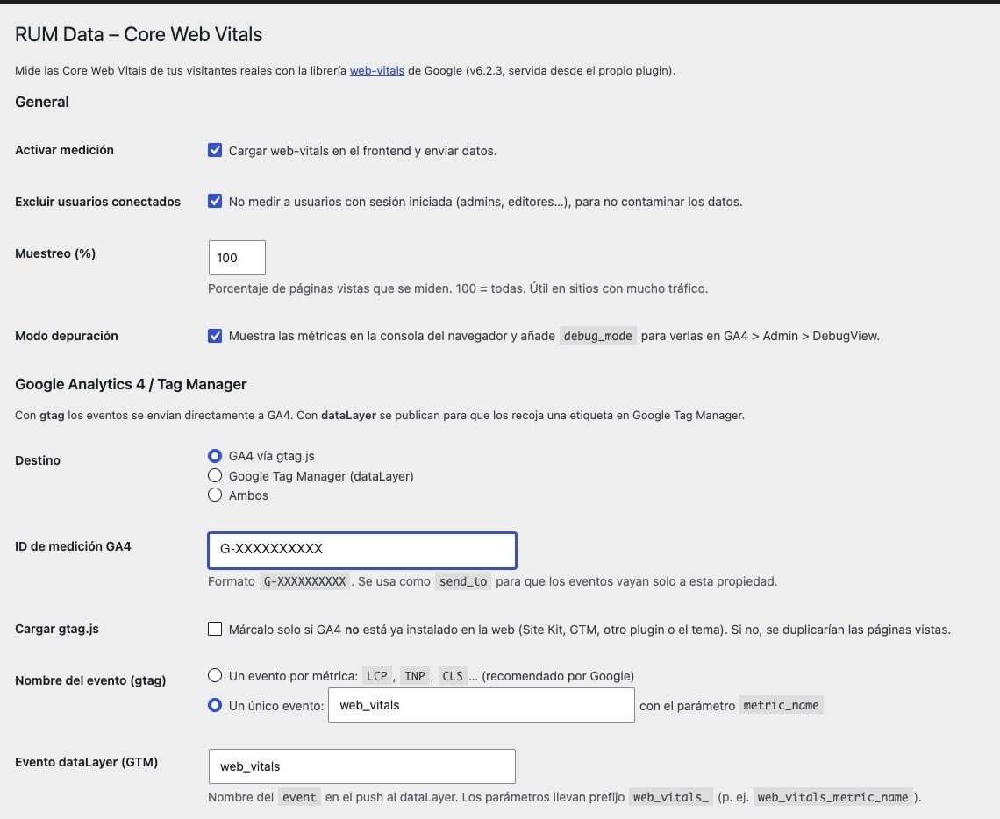
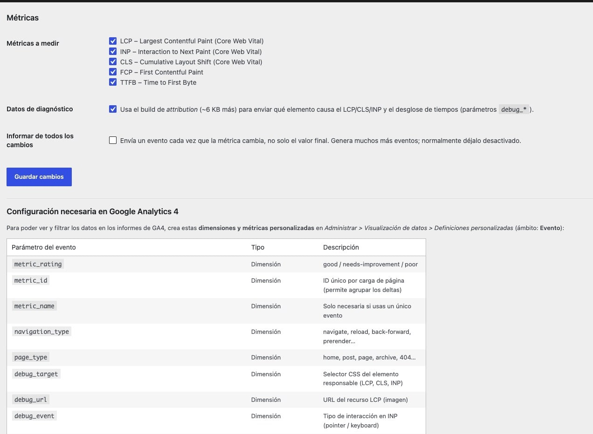

# RUM Data – Core Web Vitals para WordPress

Mide la velocidad **real** que perciben tus visitantes (no la de un test de laboratorio como PageSpeed) y la envía a **Google Analytics 4** o a **Google Tag Manager**.

Usa la librería oficial de Google [web-vitals](https://github.com/GoogleChrome/web-vitals) (v6.2.3), incluida en el propio plugin: no se carga nada desde CDNs externos.

---

## Índice

1. [Qué mide](#1-qué-mide)
2. [Instalación y configuración rápida](#2-instalación-y-configuración-rápida)
3. [Opciones del plugin](#3-opciones-del-plugin)
4. [Cuándo se envía cada métrica](#4-cuándo-se-envía-cada-métrica)
5. [Qué datos se envían y qué significan](#5-qué-datos-se-envían-y-qué-significan)
6. [Cómo se ven los eventos en GA4](#6-cómo-se-ven-los-eventos-en-ga4)
7. [Configurar GA4 (definiciones personalizadas)](#7-configurar-ga4-definiciones-personalizadas)
8. [Usarlo con Google Tag Manager](#8-usarlo-con-google-tag-manager)
9. [Consultas en BigQuery](#9-consultas-en-bigquery)
10. [Comprobar que funciona](#10-comprobar-que-funciona)
11. [Para desarrolladores (filtros)](#11-para-desarrolladores-filtros)

---

## 1. Qué mide

| Métrica | Qué significa en cristiano | Bueno | Mejorable | Malo |
|---|---|---|---|---|
| **LCP** – Largest Contentful Paint | Cuánto tarda en verse el elemento principal (imagen destacada, titular…) | ≤ 2,5 s | 2,5 – 4 s | > 4 s |
| **INP** – Interaction to Next Paint | Cuánto tarda la página en reaccionar cuando haces clic o pulsas una tecla | ≤ 200 ms | 200 – 500 ms | > 500 ms |
| **CLS** – Cumulative Layout Shift | Cuánto "salta" el contenido mientras carga (sin unidad) | ≤ 0,1 | 0,1 – 0,25 | > 0,25 |
| **FCP** – First Contentful Paint | Cuándo aparece lo primero en pantalla | ≤ 1,8 s | 1,8 – 3 s | > 3 s |
| **TTFB** – Time to First Byte | Cuánto tarda el servidor en empezar a responder | ≤ 0,8 s | 0,8 – 1,8 s | > 1,8 s |

**LCP, INP y CLS** son las *Core Web Vitals*: las que Google usa como factor de posicionamiento. Google evalúa el **percentil 75**: es decir, el 75 % de las visitas deben estar en "bueno".

> FID ya no existe: fue sustituido por INP en 2024 y eliminado de la librería.

---

## 2. Instalación y configuración rápida

1. Copia la carpeta `rum-data` en `wp-content/plugins/` y activa el plugin.
2. Ve a **Ajustes > RUM Data**.
3. Marca **Activar medición**.
4. Elige el destino:
   - **¿Ya tienes GA4 instalado** (Site Kit, otro plugin, el tema, GTM con etiqueta de Google…)? → Destino *GA4 vía gtag.js*, pon tu ID `G-XXXXXXXXXX` y **no** marques "Cargar gtag.js".
   - **¿No tienes GA4 instalado?** → Destino *GA4 vía gtag.js*, pon tu ID y **marca** "Cargar gtag.js".
   - **¿Lo gestionas todo con GTM?** → Destino *Google Tag Manager (dataLayer)* y sigue la [sección 8](#8-usarlo-con-google-tag-manager).
5. Guarda y crea las [definiciones personalizadas en GA4](#7-configurar-ga4-definiciones-personalizadas).

---

## 3. Opciones del plugin

Todas las opciones están en **Ajustes > RUM Data**:





| Opción | Para qué sirve | Recomendado |
|---|---|---|
| Activar medición | Enciende/apaga todo | ✅ |
| Excluir usuarios conectados | No mide a quien tiene sesión iniciada (tú, editores…). Ojo: si pruebas logueado, no verás nada | ✅ |
| Muestreo (%) | Mide solo un % de las páginas vistas. Útil con mucho tráfico para no gastar cuota de eventos | 100 (bajar si tienes >1M visitas/mes) |
| Modo depuración | Muestra las métricas en la consola del navegador y las envía con `debug_mode` para verlas en **DebugView** | Solo mientras pruebas |
| Destino | gtag (directo a GA4), dataLayer (GTM) o ambos | Según tu instalación |
| ID de medición GA4 | Tu `G-XXXXXXXXXX`. Se envía como `send_to` para que los eventos vayan solo a esa propiedad | Siempre |
| Cargar gtag.js | El plugin inserta la etiqueta de Google. **Solo si no está ya instalada**, o duplicarás páginas vistas | Según tu instalación |
| Nombre del evento | Un evento por métrica (`LCP`, `INP`…) o uno único (`web_vitals`) con el parámetro `metric_name` | Uno por métrica |
| Evento dataLayer | Nombre del evento que se empuja al dataLayer (modo GTM) | `web_vitals` |
| Métricas a medir | Cuáles de las 5 métricas se recogen | Todas |
| Datos de diagnóstico | Envía *por qué* una métrica es mala: qué elemento, qué imagen, desglose de tiempos (parámetros `debug_*`) | ✅ |
| Informar de todos los cambios | Envía un evento cada vez que la métrica cambia, no solo el valor final. Multiplica los eventos | ❌ (solo para pruebas) |

---

## 4. Cuándo se envía cada métrica

Las métricas **no** se envían todas a la vez al cargar la página. La librería espera a que el valor sea definitivo:

| Métrica | Se envía… |
|---|---|
| TTFB, FCP | Nada más cargar la página |
| LCP | En la primera interacción del usuario (clic, tecla, scroll) o al ocultar la pestaña |
| CLS | Al ocultar la pestaña (cambiar de pestaña, minimizar, cerrar o navegar a otra página) |
| INP | Al ocultar la pestaña, y **solo si hubo alguna interacción** |

Por eso, en una visita normal verás **entre 3 y 5 eventos por página vista**. Si alguien entra y sale sin tocar nada, no habrá INP.

---

## 5. Qué datos se envían y qué significan

### 5.1 Parámetros comunes (en todos los eventos)

| Parámetro | Ejemplo | Significado |
|---|---|---|
| `value` | `2512` | El **delta** de la métrica (en CLS, multiplicado por 1000). Al sumar todos los `value` de una misma página vista obtienes el valor final. Es el parámetro estándar de GA4, así que aparece como "Valor del evento" sin configurar nada |
| `metric_name` | `LCP` | Nombre de la métrica |
| `metric_id` | `v6-1793208978706-4892918706226` | ID único de esa métrica en esa página vista. Sirve para agrupar si se envía más de una vez |
| `metric_value` | `2512` / `0.1235` | **Valor real** de la métrica: milisegundos (o sin unidad en CLS) |
| `metric_delta` | `2512` | Cuánto ha cambiado desde el último envío (igual a `metric_value` si solo se envía una vez) |
| `metric_rating` | `good` | `good` (bueno), `needs-improvement` (mejorable) o `poor` (malo), según los umbrales de Google |
| `navigation_type` | `navigate` | Cómo llegó el usuario: `navigate` (normal), `reload` (recarga), `back-forward` (botón atrás), `back-forward-cache` (atrás instantáneo), `prerender` (precargada) |
| `page_type` | `post` | Tipo de página de WordPress: `home`, `post`, `page`, el tipo de contenido personalizado, `taxonomy`, `archive`, `search`, `404`, `other` |
| `non_interaction` | `true` | Indica que no es una acción del usuario. GA4 no lo usa; se mantiene por compatibilidad |
| `send_to` | `G-XXXXXXXXXX` | A qué propiedad de GA4 va el evento (solo en modo gtag) |
| `debug_mode` | `true` | Solo con el modo depuración activado: hace que el evento aparezca en DebugView |

> **País, ciudad, dispositivo, navegador, sistema operativo, URL e idioma no se envían**: GA4 los añade automáticamente a cada evento. Puedes cruzar cualquier métrica con ellos.

### 5.2 Parámetros de diagnóstico (con "Datos de diagnóstico" activado)

Te dicen **qué** está causando el problema.

**LCP**

| Parámetro | Significado |
|---|---|
| `debug_target` | Selector CSS del elemento LCP. Ej: `main>article>img.wp-post-image` |
| `debug_url` | URL de la imagen/recurso LCP (si lo es) |
| `debug_ttfb` | ms hasta que respondió el servidor |
| `debug_resource_load_delay` | ms desde el TTFB hasta que el navegador *empezó* a descargar la imagen. Alto = la imagen se descubre tarde (lazy-load en la imagen principal, CSS de fondo, JS…) |
| `debug_resource_load_duration` | ms que tardó en descargarse la imagen. Alto = imagen pesada o servidor lento |
| `debug_element_render_delay` | ms desde que se descargó hasta que se pintó. Alto = CSS/JS bloqueando el renderizado |

Los 4 tiempos suman el LCP total.

**INP**

| Parámetro | Significado |
|---|---|
| `debug_target` | Selector del elemento con el que se interactuó (botón, menú…) |
| `debug_event` | `pointer` (clic/toque) o `keyboard` (tecla) |
| `debug_load_state` | Estado de la página en ese momento: `loading`, `dom-interactive`, `dom-content-loaded`, `complete` |
| `debug_input_delay` | ms que la interacción esperó porque el navegador estaba ocupado con otro JS |
| `debug_processing_duration` | ms que tardaron en ejecutarse los manejadores de eventos (tu JS) |
| `debug_presentation_delay` | ms desde que acabó el JS hasta que se pintó el resultado |
| `debug_script` | URL del script que más tiempo bloqueó durante la interacción (solo Chrome) |

**CLS**

| Parámetro | Significado |
|---|---|
| `debug_target` | Selector del elemento que causó el mayor salto (típico: banner, anuncio, imagen sin dimensiones, fuente web) |
| `debug_time` | ms desde el inicio de la página en que ocurrió ese salto |
| `debug_load_state` | Estado de carga cuando ocurrió |

**FCP**

| Parámetro | Significado |
|---|---|
| `debug_ttfb` | ms hasta la respuesta del servidor |
| `debug_first_byte_to_fcp` | ms desde la respuesta hasta el primer pintado. Alto = CSS/JS/fuentes bloqueando |
| `debug_load_state` | Estado de carga |

**TTFB**

| Parámetro | Significado |
|---|---|
| `debug_waiting_duration` | ms antes de empezar (redirecciones, arranque del navegador) |
| `debug_cache_duration` | ms consultando la caché HTTP / service worker |
| `debug_dns_duration` | ms resolviendo el DNS |
| `debug_connection_duration` | ms estableciendo la conexión (TCP + TLS) |
| `debug_request_duration` | ms desde que se envía la petición hasta el primer byte. Alto = servidor/PHP lento o sin caché de página |

---

## 6. Cómo se ven los eventos en GA4

### Ejemplo: una visita a un artículo

El usuario abre un post, lee, hace clic en el menú y se va. GA4 recibe:

```
page_view   (lo envía tu instalación de GA4, no este plugin)
TTFB        value=422   metric_value=422   metric_rating=good
FCP         value=740   metric_value=740   metric_rating=good
LCP         value=2512  metric_value=2512  metric_rating=needs-improvement  debug_target=img.wp-post-image
INP         value=180   metric_value=180   metric_rating=good               debug_target=button.menu-toggle
CLS         value=123   metric_value=0.1235 metric_rating=needs-improvement debug_target=#cookie-banner
```

Lo que se envía por gtag en el caso del LCP es exactamente:

```js
gtag('event', 'LCP', {
  value: 2512,
  metric_name: 'LCP',
  metric_id: 'v6-1793208978706-4892918706226',
  metric_value: 2512,
  metric_delta: 2512,
  metric_rating: 'needs-improvement',
  navigation_type: 'navigate',
  page_type: 'post',
  non_interaction: true,
  debug_target: 'main>article>img.wp-post-image',
  debug_url: 'https://tuweb.com/wp-content/uploads/hero.jpg',
  debug_ttfb: 300,
  debug_resource_load_delay: 100,
  debug_resource_load_duration: 1900,
  debug_element_render_delay: 212,
  send_to: 'G-XXXXXXXXXX'
});
```

Si eliges **un único evento**, el nombre será `web_vitals` (o el que pongas) y la métrica irá en `metric_name`.

### Dónde mirar en GA4

**En tiempo real (para probar):** *Administrar > DebugView* con el modo depuración activado. Verás cada evento con todos sus parámetros.

**Informe rápido:** *Informes > Interacción > Eventos*. Verás `LCP`, `INP`, `CLS`… con su número de eventos. Haz clic en uno para ver sus parámetros (tras crear las definiciones personalizadas).

**Exploración recomendada** (*Explorar > Exploración libre*):

1. **Dimensiones**: `Nombre del evento`, `metric_rating`, `Ruta de la página`, `Categoría de dispositivo`, `País`, `debug_target`.
2. **Métricas**: `Número de eventos`, `metric_value` (media).
3. **Filtro**: `Nombre del evento` coincide con la expresión regular `LCP|INP|CLS`.
4. **Filas**: `Nombre del evento`; **Columnas**: `metric_rating`.

Resultado: cuántas visitas tienen LCP/INP/CLS buenos, mejorables y malos. Cambia las filas a `Ruta de la página` para ver **qué páginas fallan**, o a `debug_target` para ver **qué elemento** lo causa.

**Preguntas típicas y cómo responderlas:**

| Pregunta | Filas | Filtro |
|---|---|---|
| ¿Qué páginas tienen peor LCP? | Ruta de la página | Evento = LCP, metric_rating = poor |
| ¿Qué imagen provoca el LCP lento? | debug_url | Evento = LCP |
| ¿Qué elemento hace saltar la página? | debug_target | Evento = CLS, metric_rating ≠ good |
| ¿Qué botón va lento? | debug_target | Evento = INP |
| ¿Va peor en móvil? | Categoría de dispositivo | Evento = LCP |
| ¿Va peor en algún país? (CDN/hosting) | País | Evento = TTFB |

> GA4 muestra **medias**, no el percentil 75 que usa Google. La columna `metric_rating` es la forma más fiable de evaluarlo dentro de GA4: si más del 75 % de los eventos son `good`, vas bien. Para el p75 exacto usa [BigQuery](#9-consultas-en-bigquery).

---

## 7. Configurar GA4 (definiciones personalizadas)

GA4 recibe todos los parámetros, pero **solo puedes usarlos en informes si los registras**. Ve a *Administrar > Visualización de datos > Definiciones personalizadas > Crear dimensión personalizada*, con **ámbito: Evento**, y en "Parámetro de evento" escribe el nombre exacto.

**Dimensiones personalizadas** (las imprescindibles en negrita):

| Nombre (el que quieras) | Parámetro de evento |
|---|---|
| **Web Vitals – Rating** | `metric_rating` |
| **Web Vitals – Elemento** | `debug_target` |
| **Web Vitals – Recurso LCP** | `debug_url` |
| Web Vitals – ID | `metric_id` |
| Web Vitals – Métrica | `metric_name` (solo si usas un único evento) |
| Web Vitals – Tipo de navegación | `navigation_type` |
| Web Vitals – Tipo de página | `page_type` |
| Web Vitals – Tipo de interacción | `debug_event` |
| Web Vitals – Estado de carga | `debug_load_state` |
| Web Vitals – Script INP | `debug_script` |

**Métricas personalizadas** (*Crear métrica personalizada*, ámbito Evento):

| Nombre | Parámetro | Unidad |
|---|---|---|
| **Web Vitals – Valor** | `metric_value` | Estándar (CLS no tiene unidad y LCP/INP van en ms; filtra siempre por evento) |
| LCP – Retraso de carga | `debug_resource_load_delay` | Milisegundos |
| LCP – Duración de carga | `debug_resource_load_duration` | Milisegundos |
| LCP – Retraso de renderizado | `debug_element_render_delay` | Milisegundos |
| TTFB | `debug_ttfb` | Milisegundos |
| INP – Retraso de entrada | `debug_input_delay` | Milisegundos |
| INP – Procesamiento | `debug_processing_duration` | Milisegundos |
| INP – Presentación | `debug_presentation_delay` | Milisegundos |

> Las definiciones **no son retroactivas**: solo verás datos desde que las crees. Créalas el mismo día que actives el plugin. Los datos tardan hasta 24-48 h en aparecer en informes (DebugView es inmediato).

---

## 8. Usarlo con Google Tag Manager

En modo **dataLayer**, el plugin no habla con GA4: publica los datos y tú decides en GTM qué hacer con ellos (enviarlos a GA4, a otra herramienta, o a ambas).

### Lo que llega al dataLayer

```js
dataLayer.push({
  event: 'web_vitals',
  web_vitals_value: 2512,
  web_vitals_metric_name: 'LCP',
  web_vitals_metric_id: 'v6-1793208978706-4892918706226',
  web_vitals_metric_value: 2512,
  web_vitals_metric_delta: 2512,
  web_vitals_metric_rating: 'needs-improvement',
  web_vitals_navigation_type: 'navigate',
  web_vitals_page_type: 'post',
  web_vitals_non_interaction: true,
  web_vitals_debug_target: 'main>article>img.wp-post-image',
  web_vitals_debug_url: 'https://tuweb.com/wp-content/uploads/hero.jpg',
  // ... resto de debug_* según la métrica
});
```

Mismos datos que en la [sección 5](#5-qué-datos-se-envían-y-qué-significan), con el prefijo `web_vitals_`.

### Configuración en GTM, paso a paso

**1. Variables** (*Variables > Variables definidas por el usuario > Nueva > Variable de capa de datos*). Crea una por parámetro que quieras usar:

| Nombre de la variable en GTM | Nombre de la variable de capa de datos |
|---|---|
| `DLV - WV metric_name` | `web_vitals_metric_name` |
| `DLV - WV value` | `web_vitals_value` |
| `DLV - WV metric_id` | `web_vitals_metric_id` |
| `DLV - WV metric_value` | `web_vitals_metric_value` |
| `DLV - WV metric_rating` | `web_vitals_metric_rating` |
| `DLV - WV navigation_type` | `web_vitals_navigation_type` |
| `DLV - WV page_type` | `web_vitals_page_type` |
| `DLV - WV debug_target` | `web_vitals_debug_target` |
| `DLV - WV debug_url` | `web_vitals_debug_url` |
| … | … (el resto de `web_vitals_debug_*` que necesites) |

**2. Activador** (*Activadores > Nuevo > Evento personalizado*):
- Nombre del evento: `web_vitals`

**3. Etiqueta** (*Etiquetas > Nueva > Google Analytics: evento de GA4*):
- ID de medición: tu `G-XXXXXXXXXX` (o tu variable de configuración)
- Nombre del evento: `{{DLV - WV metric_name}}` → creará los eventos `LCP`, `INP`, `CLS`…
- Parámetros del evento:

| Nombre del parámetro | Valor |
|---|---|
| `value` | `{{DLV - WV value}}` |
| `metric_id` | `{{DLV - WV metric_id}}` |
| `metric_value` | `{{DLV - WV metric_value}}` |
| `metric_rating` | `{{DLV - WV metric_rating}}` |
| `navigation_type` | `{{DLV - WV navigation_type}}` |
| `page_type` | `{{DLV - WV page_type}}` |
| `debug_target` | `{{DLV - WV debug_target}}` |
| `debug_url` | `{{DLV - WV debug_url}}` |
| … | … |

- Activación: el activador `web_vitals` del paso 2.

**4.** Prueba con *Vista previa* de GTM, comprueba en DebugView de GA4 y publica.

Usa **los mismos nombres de parámetro** que en la sección 5 (sin el prefijo): así las [definiciones personalizadas de GA4](#7-configurar-ga4-definiciones-personalizadas) sirven igual.

> ⚠️ Si eliges el destino **"Ambos"** y además envías a GA4 desde GTM con esta etiqueta, **cada métrica llegará dos veces** a GA4. "Ambos" tiene sentido solo si GTM envía los datos a *otra* herramienta.

---

## 9. Consultas en BigQuery

Si enlazas GA4 con BigQuery (*Administrar > Vinculaciones de BigQuery*, gratis hasta cierto volumen), puedes calcular el **percentil 75** igual que Google.

**p75 de cada métrica por página (últimos 28 días):**

```sql
WITH vitals AS (
  SELECT
    event_name AS metric,
    (SELECT value.string_value FROM UNNEST(event_params) WHERE key = 'metric_id') AS metric_id,
    (SELECT value.string_value FROM UNNEST(event_params) WHERE key = 'page_location') AS page,
    device.category AS device,
    geo.country AS country,
    (SELECT COALESCE(value.double_value, CAST(value.int_value AS FLOAT64))
       FROM UNNEST(event_params) WHERE key = 'metric_value') AS metric_value
  FROM `TU_PROYECTO.analytics_XXXXXXXXX.events_*`
  WHERE _TABLE_SUFFIX BETWEEN FORMAT_DATE('%Y%m%d', DATE_SUB(CURRENT_DATE(), INTERVAL 28 DAY))
                          AND FORMAT_DATE('%Y%m%d', CURRENT_DATE())
    AND event_name IN ('LCP', 'INP', 'CLS', 'FCP', 'TTFB')
),
-- Si una métrica se envió varias veces en la misma página vista, nos quedamos con el valor final.
final AS (
  SELECT metric, page, device, country, MAX(metric_value) AS metric_value
  FROM vitals
  GROUP BY metric, metric_id, page, device, country
)
SELECT
  metric,
  page,
  COUNT(*) AS visitas,
  APPROX_QUANTILES(metric_value, 100)[OFFSET(75)] AS p75
FROM final
GROUP BY metric, page
HAVING visitas >= 50
ORDER BY metric, p75 DESC;
```

Cambia `page` por `device` o `country` en el `SELECT` y el `GROUP BY` final para ver el p75 por dispositivo o país.

---

## 10. Comprobar que funciona

1. Activa **Modo depuración** en los ajustes.
2. Abre la web en una **ventana privada** (recuerda: los usuarios conectados se excluyen por defecto).
3. Abre la consola del navegador (F12). Verás líneas como:
   ```
   [RUM Data] FCP {value: 740, metric_name: 'FCP', metric_rating: 'good', …}
   [RUM Data] TTFB {value: 422, …}
   ```
4. Haz **clic** en cualquier parte → aparece **LCP**.
5. **Cambia de pestaña** y vuelve → aparecen **CLS** e **INP**.
6. En la pestaña **Red** filtra por `collect`: verás las peticiones a GA4 (`...&en=LCP...`).
7. En GA4, **Administrar > DebugView**: los eventos aparecen en segundos.
8. Cuando todo esté bien, **desactiva el modo depuración**.

**Problemas frecuentes:**

| Síntoma | Causa |
|---|---|
| No sale nada en consola | Estás logueado, la medición no está activada, o el muestreo es < 100 % y te ha tocado no medirte |
| Salen FCP y TTFB pero no el resto | Normal: interactúa y cambia de pestaña (ver [sección 4](#4-cuándo-se-envía-cada-métrica)) |
| Sale en consola pero no hay peticiones `collect` | gtag.js no está cargado en la página: activa "Cargar gtag.js" o revisa tu instalación de GA4 |
| Hay peticiones pero no aparece en GA4 | Un bloqueador de anuncios, Consent Mode denegado, o el ID de medición es de otra propiedad |
| Páginas vistas duplicadas en GA4 | Has marcado "Cargar gtag.js" teniendo GA4 ya instalado |
| En los informes no veo `metric_rating`, `debug_target`… | Faltan las [definiciones personalizadas](#7-configurar-ga4-definiciones-personalizadas), o se crearon hace menos de 24-48 h |

---

## 11. Para desarrolladores (filtros)

**No medir ciertas páginas:**

```php
add_filter( 'rum_data_should_track', function ( $track ) {
	return is_checkout() ? false : $track; // p. ej. no medir el checkout de WooCommerce
} );
```

**Modificar la configuración enviada al navegador** (por ejemplo, un `page_type` propio):

```php
add_filter( 'rum_data_js_config', function ( $config ) {
	if ( function_exists( 'is_product' ) && is_product() ) {
		$config['pageType'] = 'product';
	}
	return $config;
} );
```

**Configuración disponible en JS:** `window.rumDataConfig`.

---

## Licencias

- Plugin: GPL-2.0-or-later.
- web-vitals: Apache-2.0 (© Google LLC), ver `assets/vendor/LICENSE`.
